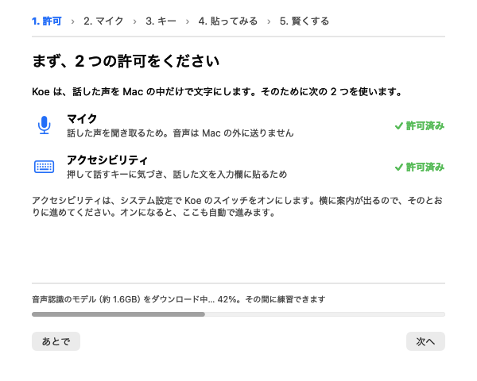
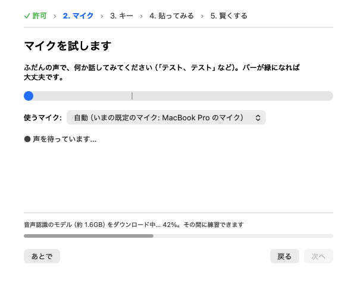
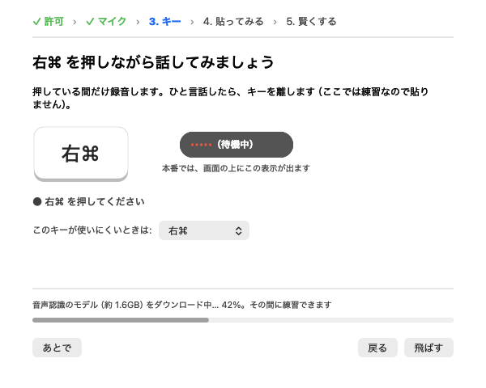
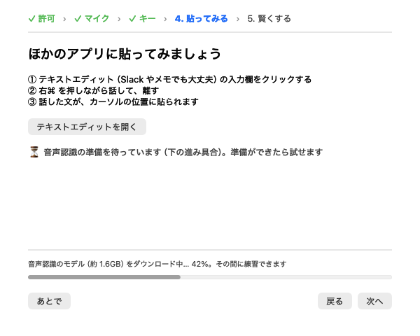
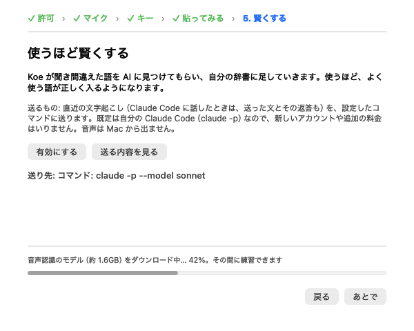
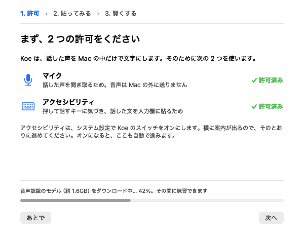
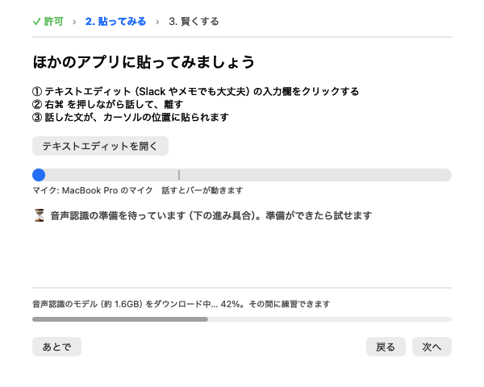
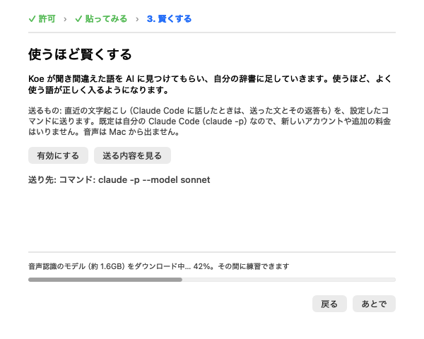

# 初回の案内: 3 案の比べ方（chaspy が 1 つ選ぶため）

**B `auto`（自動で進む）に決定（2026-10-19、chaspy）。** A `steps` と C `short` の流れと、案を切り替える設定は外した。`defaults write io.github.chaspy.koe onboarding on` でオン（既定オフのまま。既定でオンにするかは別に決める）。前の案の名前（`steps` / `auto` / `short`）が残っていても、オンとして B の流れで開く。以下は選ぶときに使った比べ方で、記録として残している。

初回の案内（#137、既定オフ）には、流れの案が 3 つあります。`defaults write io.github.chaspy.koe onboarding <案>` で切り替えます。選ばれなかった案は、あとで消します（ゴールの残り 2）。

画面は 2026-10-19 の `main`（#137・#176 入り）から、案内の窓だけを小さな main と一緒にコンパイルして描き出したものです。モデルは「ダウンロード中 42%」、改善ループは「未決定・使える」の状態にしています。描き出しに使ったプロセスは許可を持っているため、許可の段は 2 つとも「許可済み」と出ています（実際の Koe では、両方そろっていれば許可の段は飛ばします）。

## 違いの一覧

| | A `steps`（順に） | B `auto`（自動で進む） | C `short`（短く） |
|---|---|---|---|
| 段 | 許可 → マイク → キー → 貼ってみる（→ 賢くする） | A と同じ 5 段 | 許可 → 貼ってみる（→ 賢くする） |
| 進み方 | 各段で「次へ」 | マイクが聞こえたら 1 秒後、キーの練習ができたら 1.2 秒後に自分で次へ。「次へ」でも進める | 各段で「次へ」 |
| 画面 | 下の 5 枚 | **A とまったく同じ画面**（画像もバイト単位で一致）。違うのは進み方だけ | 貼る段に、マイクの揺れのバーとマイク名を出す（マイクの段が無いため） |
| マイクの確認 | 専用の段（0.4 秒聞こえたら合格。6 秒聞こえなければ直し方と「このまま進む」） | A と同じ | 貼る段のバーだけ（合格の判定は無い） |
| キーの練習 | 専用の段（練習中は貼らない。短すぎ・声なし・ほかのキーを言い分ける） | A と同じ | なし（いきなり本番で貼る） |
| 「次へ」などのクリック（許可済み・賢くするの段あり） | 4 回（マイク・キー・貼ってみる・賢くする） | 2 回（貼ってみる・賢くする） | 2 回（貼ってみる・賢くする） |
| 同（賢くするの段なし＝改善ループを決め済み） | 3 回 | 1 回 | 1 回 |

クリックの回数には、許可の段（そろうと 0.8 秒後にどの案でも自分で進む）、「テキストエディットを開く」、「有効にする」のあとの確認ダイアログは入れていません。「賢くする」の段は改善ループのオン・オフがまだ決まっていないときだけ出ます（#176）。

## 段ごとの文言（A・B 共通。C は許可・貼ってみる・賢くするの 3 段）

| 段 | 見出し | 本文の要点 | 右下のボタン |
|---|---|---|---|
| 1 許可 | まず、2 つの許可をください | マイク（音声は Mac の外に送らない）とアクセシビリティ（キーに気づき、入力欄に貼る）。システム設定の横に案内が出る | 次へ（そろうまで押せない） |
| 2 マイク | マイクを試します | 「テスト、テスト」などと話し、バーが緑になれば大丈夫。使うマイクをここで変えられる | 次へ（聞こえるまで押せない） |
| 3 キー | 右⌘ を押しながら話してみましょう | 押している間だけ録音。練習なので貼らない。本番の表示（帯）の見本。キーをここで変えられる | 飛ばす → 練習できたら「次へ」 |
| 4 貼ってみる | ほかのアプリに貼ってみましょう | ①入力欄をクリック ②押しながら話して離す ③カーソルの位置に貼られる。テキストエディットを開くボタン | 次へ（賢くするが無ければ「完了」） |
| 5 賢くする | 使うほど賢くする | 聞き間違えた語を辞書に足していく。送るもの・送り先（既定は自分の Claude Code）・音声は出ない | あとで（有効にしたら「完了」） |

## 画面

### A `steps`（B `auto` も同じ画面）

| 1 許可 | 2 マイク | 3 キー |
|---|---|---|
|  |  |  |

| 4 貼ってみる | 5 賢くする |
|---|---|
|  |  |

### C `short`

| 1 許可 | 2 貼ってみる（マイクのバーつき） | 3 賢くする |
|---|---|---|
|  |  |  |

C の段の見出し（上の行）は「✓ 許可 › 2. 貼ってみる › 3. 賢くする」の 3 つだけです。

## 選ぶときの見どころ

- **A と B は画面が同じ**で、違いは待つか自分で進むかだけです。B は説明を読まない人に向き、A は自分のペースで読みたい人に向きます
- **C はマイクとキーの練習が無い**ので最短ですが、声が入っていない・キーの押し方が分からない、という初回のつまずきを本番の 1 回目で見つけることになります
- どれを選んでも、許可がそろっていれば許可の段は飛ばし、改善ループを決め済みなら最後の段は出ません

## 撮り直し方

`docs/notes/onboarding-variants/` の画像は、案内の窓（`OnboardingWindow.swift` ほか）を小さな main と一緒に `swiftc` でコンパイルし、案ごとに `go(段)` で順に出して `cacheDisplay` で PNG にしたものです。手順はこの PR の本文にあります。
